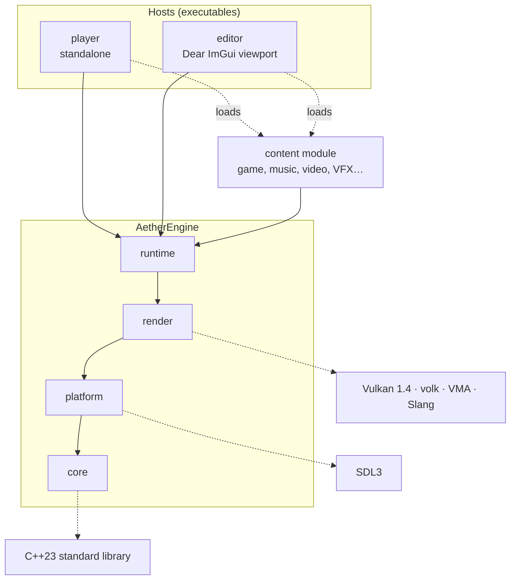

In November 2026, AetherEngine restarted from an empty repository. The
previous code base is archived in
[AetherEngine-legacy](https://github.com/AIperture-Labs/AetherEngine-legacy);
the new one is C++23 on Vulkan, built with CMake and Ninja, with Python for
editor automation and Lua for game scripting.

Before any rendering code, the first thing worth settling is the shape of the
engine: which modules exist, what each one is allowed to know about, and how
a game (or anything else built on the engine) plugs into it. Changing these
later means touching every file. This post walks through the model as it
stands in the [architecture document](https://github.com/AIperture-Labs/AetherEngine/blob/f95606fbbfba9b64f6652326283609cbba3fccc8/docs/architecture.md),
and, more importantly, the reasons behind it.

## Four modules, one direction



The engine is a stack of four modules, and each module depends only on the
ones below it:

| Module | Depends on | Content |
| --- | --- | --- |
| `core` | the C++23 standard library | Base types, logger, assertions, errors with `std::expected`, memory |
| `platform` | `core`, SDL3 | The only module talking to the OS: window, events, input, files, time, shared-library loading, Vulkan surface |
| `render` | `core`, `platform`, Vulkan (volk, VMA) | Instance and device, swapchain, pipelines, frame synchronization, deferred deletion, Slang shaders |
| `runtime` | `core`, `platform`, `render` | The main loop and the content lifecycle, shared by the hosts |

The rule is strict: never upwards, never sideways around the stack. `core`
does not know a window exists; `platform` is the only place that includes an
OS or SDL header; `render` never asks the OS anything directly. A
single direction keeps each module testable on its own, and it makes the
build graph match the mental one.

## Content, not "the game"

The engine does not assume the thing it runs is a game. A project may be a
game, a demo, a piece of music, a video or a VFX sequence. All of them build
the same thing: a **content module**, which implements one interface and
declares itself with one macro.

```cpp
// <aether/runtime/content.hpp>
namespace aether::runtime {

class IContent {
public:
    virtual ~IContent() = default;

    [[nodiscard]]
    virtual Status init(Runtime &runtime) = 0;
    [[nodiscard]]
    virtual Status update(f32 deltaSeconds) = 0;
};

struct ContentDescriptor {
    const char *engineVersion;         // core::kVersionString of the content's build
    const void *coreIdentity;          // core::identity(), as the content sees it
    core::EBuildProfile buildProfile;  // core::kBuildProfile of that build
    const char *name;
    IContent *(*create)();
};

}  // namespace aether::runtime

// In one source file of the content; defines
// extern "C" const ContentDescriptor *aetherContent();
AETHER_CONTENT(MyProject)
```

`runtime` reads the descriptor, creates the content, calls `init`, then
`update` every frame, and destroys it before the renderer and the platform
shut down. Errors travel as values: `init` and `update` return a `Status`,
and a failure is logged and stops the host cleanly with a non-zero exit code.
The engine does not throw; that choice deserves its own post.

Project *types* (game, music, video…) are templates picked when a project is
created in the editor. They choose plugins and exports (an executable, a video
or audio file), not a different kind of content.

### Time comes from the caller

Content never reads the clock. It only sees the `deltaSeconds` that `runtime`
hands to `update`. A real-time host passes the elapsed time; a future offline
host, exporting a video or an audio file, passes a fixed step. The same
content runs identically in both, which is exactly what you want when the
"game" is a music video rendered frame by frame.

### Hosts stay thin

Two executables run content:

- `player` runs it standalone, full screen.
- `editor` runs it inside a Dear ImGui viewport.

Both just parse their arguments and hand the content to `runtime`. To make
this possible, `render` always draws into an offscreen image; the host then
either presents it to the window or shows it in an ImGui panel. The content
cannot tell the difference.

## A context instead of globals

`Runtime` is the engine context. It owns the subsystems (the window, the
renderer, and later audio, assets…) and is handed to the content in `init`.
Every engine module above `core` keeps its state in objects like this one,
never in globals. Two benefits follow: creation and shutdown order is
explicit in code rather than left to static initialization, and a test can
simply create its own instance.

Only the services any code must reach without being handed anything are
global, and they live in `core`: the logger and the assertion handler (later
the allocator and the profiler).

## Two build modes, one rule

The engine builds in two modes, selected by `BUILD_SHARED_LIBS` through the
CMake presets:

| Mode | Engine modules | Content | Used for |
| --- | --- | --- | --- |
| Dynamic | Shared libraries | Shared library, loaded by the host at run time | Development, the editor, later hot reload |
| Monolithic | Static libraries | Static library, linked into one executable | Shipping |

In dynamic mode, the generic `player` takes the content library's path on its
command line. In monolithic mode, `aether_add_module(<name> CONTENT …)` also
produces an executable `<name>`: the player's `main` linked with the content,
calling `aetherContent()` directly.

Supporting both modes is where most of the subtle rules come from, and they
all serve one invariant.

### One copy of each engine state

Each piece of global state (the logger and its sinks, the internal state of
SDL and volk) must exist **once** in the process. A second copy does not
crash; it silently works on its own. Content that ends up with its own copy of
`core` logs happily into a logger nobody listens to. Hence:

- **Engine and content share one mode.** The CMake API cannot build a static
  engine with dynamically loaded content.
- **Third-party state has one owner.** SDL3 is linked into `platform` only,
  volk and VMA into `render` only. Content and other modules go through those
  modules, never link the library themselves.
- **Globals live in source files.** They are reached through an exported
  function, never defined in a header. Symbols are hidden by default, so an
  `inline` variable, or a `static` local in an `inline` function, would exist
  once per shared library.
- **One heap.** The C and C++ runtimes are linked dynamically in both
  triplets, so memory allocated on one side of a library boundary can be
  freed on the other.
- **One `bin/` directory.** Executables and shared libraries are built side by
  side, so each library is found, and loaded, exactly once.

### Refusing bad content early

Because the C++ interface is not stable across engine versions, `runtime`
checks the descriptor before creating anything, and refuses the content with
a `Fatal` log when:

- `engineVersion` differs from its own: the content was built against another
  engine;
- `coreIdentity` differs from its own `core::identity()`: the content carries
  its own copy of `core`, the exact failure described above;
- `buildProfile` differs: assertions and log macros would be compiled
  differently on each side of the boundary.

In monolithic mode, all three pass by construction. In dynamic mode, they turn
a class of baffling bugs into one clear error message at startup.

## What comes next

None of this draws a triangle yet, and that is deliberate: the module
boundaries, the context and the linking rules are the parts that are hardest
to change later. The next posts follow the code as it fills these modules in,
starting with `core`: errors as values, the logger, and why the engine stays
away from exceptions.
